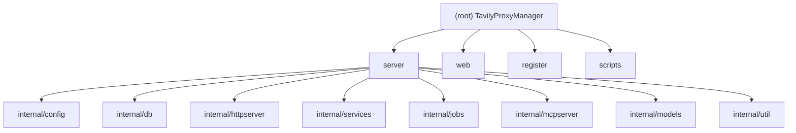

# TavilyProxyManager

> Tavily API 代理池与管理面板 -- 将多个 Tavily API Key 聚合在一个 Master Key 之后，提供智能路由、自动故障切换、MCP 支持和 Web UI 管理界面。

---

## 项目愿景

提供一个开箱即用的 Tavily API 反向代理，将多个 Tavily API Key（额度/credits）汇聚为统一入口。通过 Master Key 鉴权，智能分配请求到剩余额度最高的 Key，自动处理 Key 失效与额度耗尽，并通过内置 Web UI 实现可视化管理。

---

## 架构总览

- **后端**：Go 1.26.10+，Gin HTTP 框架，GORM + SQLite 持久化，单二进制部署
- **前端**：Vue 3 + TypeScript + Naive UI + ECharts，Vite 构建，编译后嵌入 Go 二进制
- **协议**：HTTP REST API + MCP (Model Context Protocol)
- **部署**：Docker / Docker Compose（多阶段构建），CI 通过 GitHub Actions 自动发布到 GHCR
- **辅助工具**：Python 3.12+ 批量注册脚本（`register/`），使用临时邮箱 + 视觉模型识别验证码

---

## 模块结构图



---

## 模块索引

| 模块 | 路径 | 语言 | 职责 |
|------|------|------|------|
| **server** | `server/` | Go | 后端核心：HTTP API、代理引擎、Key 池管理、MCP 服务、定时任务、数据层 |
| **web** | `web/` | TypeScript/Vue | 前端管理面板：Dashboard、Key 管理、日志查看、系统设置 |
| **register** | `register/` | Python | 辅助工具：Tavily 账户批量注册、验证码识别、API Key 自动获取 |
| **scripts** | `scripts/` | Shell/PowerShell | 构建脚本：前端编译 + Go 交叉编译 |

---

## 运行与开发

### 环境要求

- **Docker / Docker Compose** (推荐部署方式)
- **Go** 1.26.10+ / **Node.js** 20+ (本地开发)
- **Python** 3.12+ / **uv** (仅 `register` 模块)

### 快速启动（Docker）

```bash
docker-compose up -d
# 查看自动生成的 Master Key：
docker logs tavily-proxy 2>&1 | grep "master key"
```

### 本地开发

```bash
# 后端
go run ./server

# 前端（另一个终端）
cd web && npm install && npm run dev
```

### 构建

```bash
# Linux/macOS
./scripts/build_all.sh

# Windows
.\scripts\build_all.ps1

# Docker 本地构建
docker build -t my-tavily-proxy .
```

### 配置（环境变量）

| 变量 | 说明 | 默认值 |
|------|------|--------|
| `LISTEN_ADDR` | 服务监听地址 | `:8080` |
| `DATABASE_PATH` / `DB_PATH` | SQLite 数据库路径 | `./server/data/app.db` |
| `TAVILY_BASE_URL` | 上游 Tavily API 地址 | `https://api.tavily.com` |
| `UPSTREAM_TIMEOUT` | 上游请求超时 | `150s` |

---

## 测试策略

- **后端测试**：Go 标准 `testing` 包，使用 `httptest.Server` 模拟上游
  - `server/internal/httpserver/` -- 路由层测试（Key 导出、Legacy API Key 兼容、日志过滤）
  - `server/internal/services/` -- 服务层测试（代理日志开关、额度同步状态机、并发控制、请求间隔）
  - 运行：`cd server && go test ./...`
- **前端测试**：目前无自动化测试
- **register 模块**：目前无自动化测试
- **CI**：GitHub Actions（`.github/workflows/docker-publish.yml`）-- 仅构建并推送 Docker 镜像，不包含测试阶段

---

## 编码规范

### Go (server)

- 使用 `slog` 结构化日志
- 服务层通过依赖注入（`Dependencies` struct）解耦
- 数据模型使用 GORM tag，`AutoMigrate` 管理 schema
- API Key 在响应中做掩码处理（`util.MaskAPIKey`）
- 常量时间比较 Master Key（`crypto/subtle.ConstantTimeCompare`）

### TypeScript/Vue (web)

- Composition API + `<script setup>` 语法
- Naive UI 组件库，ECharts 图表
- Axios 拦截器自动注入 Bearer token，401 自动清除 key
- 国际化通过自定义 `i18n.ts` 实现（en / zh-CN）

### Python (register)

- Python >= 3.12，使用 `uv` 管理依赖
- 类型注解（`str | None` 语法）
- `requests.Session` 驱动 HTTP 流程

---

## AI 使用指引

- 核心入口：`server/main.go` -- 服务启动、依赖装配、定时任务注册
- 代理核心逻辑：`server/internal/services/tavily_proxy.go` -- Key 选择、请求转发、故障切换
- API 路由定义：`server/internal/httpserver/router.go` -- 所有 REST API 端点
- 数据模型：`server/internal/models/models.go` -- APIKey、RequestLog、RequestStat、Setting
- MCP 工具定义：`server/internal/mcpserver/mcpserver.go` -- search/extract/crawl/map/usage
- 前端入口：`web/src/App.vue` -- 侧边栏导航、Master Key 认证模态框
- 前端 API 客户端：`web/src/api/client.ts` -- Axios 实例与拦截器

### 关键路径

1. 客户端请求 -> `router.go` NoRoute -> Master Key 鉴权 -> `handleProxy` -> `TavilyProxy.Do`
2. `TavilyProxy.Do` -> `KeyService.Candidates`（按剩余额度排序、同额度随机打散） -> 逐 Key 尝试
3. 401/429/432/433 -> 自动标记 Key 失效/耗尽 -> 尝试下一个 Key
4. 定时任务：月初额度重置、自动额度同步、日志清理

---

## 变更记录 (Changelog)

| 时间 | 操作 | 说明 |
|------|------|------|
| 2026-02-13 19:14:52 | 初始生成 | 首次全仓扫描，覆盖全部模块 |
